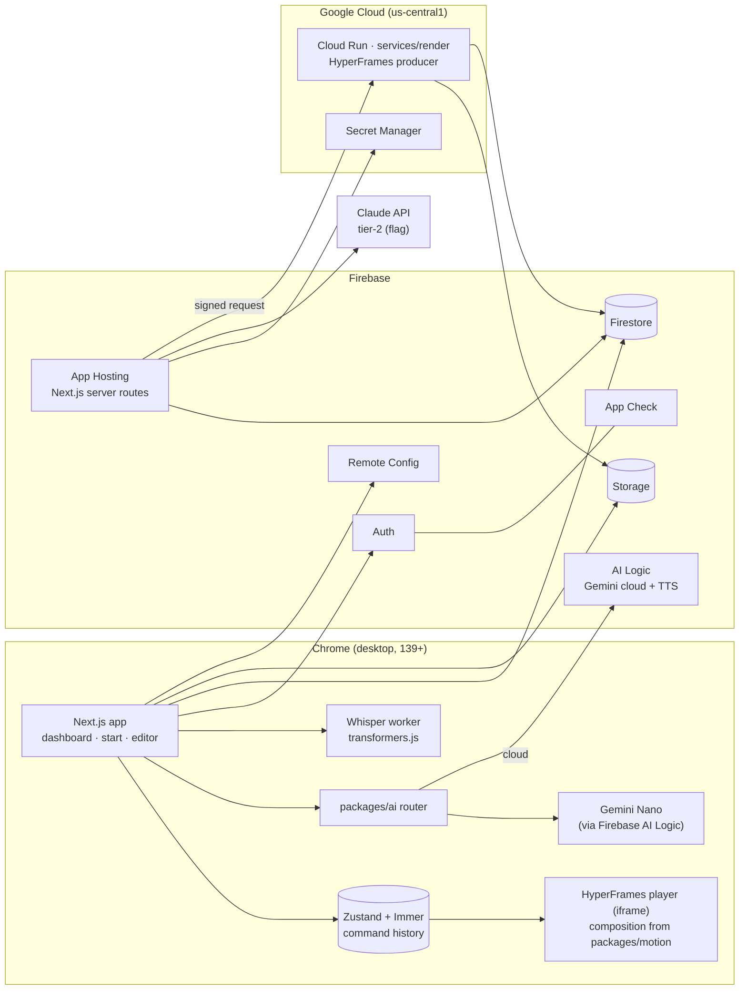

# Architecture

## System overview


## Responsibilities
| Part | Owns |
|---|---|
| `apps/web` client | UI, editor store + commands, preview player, recording, Whisper worker, on-device AI via the router |
| `apps/web` server routes | credit deduction, render job creation, tier-2 Claude calls, share links, judge plan grants |
| `packages/schemas` | zod schemas + types for every boundary; time helpers |
| `packages/motion` | motion core, components, style packs, compiler (project → HyperFrames HTML), runtime (hf-seek bridge, captions), SFX synth |
| `packages/ai` | router (device vs cloud), tasks, prompts, validation + repair, cost accounting, providers |
| `services/render` | Cloud Run: HyperFrames producer renders the compiled composition → MP4/WebM → Storage; progress → Firestore |

## Video engine
```
Project JSON (slots + params + style + format + transcript + audio)
  │ packages/motion/compiler
  ▼
HyperFrames composition (index.html)
  ├─ <audio> voice, music, synthesized SFX
  ├─ one .clip per slot: data-start = startMs/1000, data-duration = (endMs-startMs)/1000
  │    └─ component DOM/SVG from component.build(ctx, params)
  ├─ captions host
  └─ runtime.js: addEventListener("hf-seek", e => seekAll(e.detail.time))
        → for each active slot: composition.seek(t - slotStart)   // pure function of t
  ├─ Preview: <hyperframes-player> in the editor (sandboxed iframe)
  ├─ Checks:  pnpm motion:check + @hyperframes/lint (tier-2)
  └─ Export:  services/render → @hyperframes/producer → MP4 (H.264, 30 fps) / WebM alpha
```
**Parity:** the same composition HTML runs in preview and render. A parity test compares stills at 5 timestamps.

## Main flows
1. **Voiceover → slots:** record / upload / TTS → upload original → Whisper word timings (fallback `transcribe.cloud`) → fillers + pauses > 700 ms → EDL → OfflineAudioContext → cleaned audio + re-timed words → Storage + Firestore → pre-pass tagger (numbers, places, names) → `slots.detect` → post-pass (snap, de-overlap, gaps) → slots saved as `suggested` → **auto-fill** each slot on-device (`component.fill`) in the background.
2. **Generate (tier 1):** click slot → `prompt.prefill` (device) → Generate → `component.fill` in the cloud (3 credits, shown first) → zod-validate → new version → preview re-mounts that clip → "Ready in Xs".
3. **Custom (tier 2):** server route → `custom.compose` (Claude or Gemini per flag) with director skill + style pack + contract → HTML fragment on our motion core → lint (determinism, no network) → sandbox stills → layout checks → version. Fail → one retry → offer nearest library component.
4. **Quick edit / frame note:** `edit.patch` or `note.fix` (PREFER_ON_DEVICE; notes send a JPEG crop) → RFC 6902 patch → apply + re-validate → new version. Invalid → one repair → cloud. Works offline.
5. **Pip plan:** `pip.plan` (cloud) → `Plan { steps[] }` → plan card → Apply all → one composite command (single undo).
6. **Export:** modal → server checks + deducts credits → `renders/{id}` → signed call to Cloud Run → producer renders, muxes voice + music + SFX → Storage → progress in Firestore → Ready modal (download, share link). Failure refunds credits.

## Time and units
- Source of truth: **integer milliseconds** from the start of the cleaned voiceover.
- Frames are derived at render: `frame = Math.round(ms * fps / 1000)`, fps 30. Helpers in `packages/schemas/src/time.ts`. Never store float seconds.

## Failure handling (always visible, never silent)
| Failure | Behaviour |
|---|---|
| On-device model unavailable | toast "Using cloud AI", chips switch to ☁ |
| Invalid AI JSON | 1 repair → fallback (cloud or component defaults) |
| Generation fails | slot `failed`: "Couldn't generate" · Retry · Use a template |
| Render fails | render doc `error`, toast with Retry; credits refunded |
| Offline | banner; on-device edits keep working; cloud actions disabled with a reason |
| Out of credits | Pip "needs a recharge" modal; on-device edits still free |
