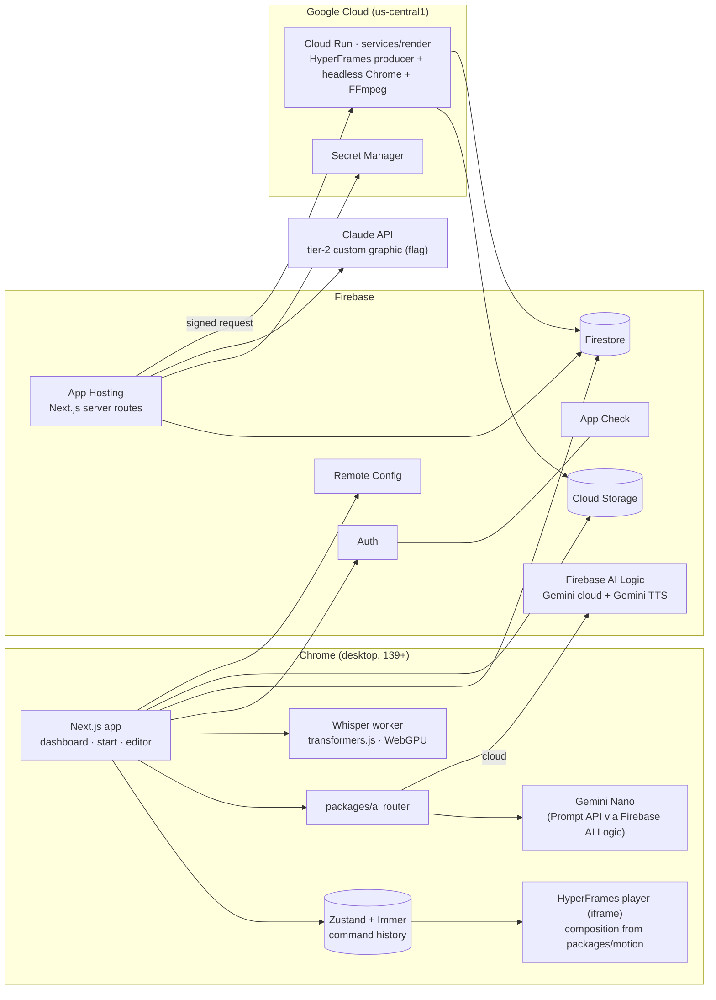

# Motionpop: locked build plan

> v1 · 2026-11-14 · Status: **APPROVED** (with changes: 20 free credits, email/password sign-in). This is the single source for `.kiro/steering/` and the specs. Written with Claude Code.

**Motionpop: bring your voice, we'll bring the motion.** You record, upload or paste a voiceover. Motionpop gets word-level timings, finds the moments that deserve a graphic, and fills a hand-crafted motion component (chart, number, title, map, callout) that lands on the exact word. Small edits run on-device with Gemini Nano: instant, free, private. Heavy creative work runs in the cloud. Export renders the same composition to MP4.

One codebase, two submissions:

| | #BuildHybridAI (Firebase) | Kiroween (Kiro) |
|---|---|---|
| Deadline (CET) | **Mon Nov 30, 23:00** (we submit by 18:00) | **Fri Dec 4, 23:00** (we submit by 18:00) |
| Must show | Firebase AI Logic **hybrid inference** (Gemini Nano on Chrome + cloud) imported and called; App Check; Auth/Firestore/Storage/Remote Config used meaningfully | Built with Kiro (specs, steering, hooks, MCP, PBT, powers, agents); `/.kiro` at root; category Frankenstein |
| Freeze | tag `buildhybridai-submission`; frozen deploy live to Dec 16 | `main`; deploy live to Jan 29, 2027 |
| Bonus | Best Web/Chrome App | Best Startup, **Best Student Project** (solo student ✓), blog, social |

---

## 1. Ground rules (non-negotiable)

1. **The designs are the truth.** `design/screens/*.png` and `design/figma-export.css` (Figma export). Match layout, tokens and copy exactly. Where any doc disagrees, the design wins. Then add life: the UI must feel poppy, playful and animated.
2. **Firebase AI Logic is the AI backbone at runtime.** Every runtime AI call goes through `packages/ai` (router + zod + cost). The user always sees where an action runs: `⚡ free · on-device` or `☁ N credits`.
3. **HyperFrames renders the video, with no GSAP shipped.** GSAP's licence forbids no-code animation tools that compete with Webflow. Our own deterministic motion core drives HyperFrames through its `hf-seek` protocol.
4. **Determinism.** Every frame is a pure function of time. Time is stored as integer ms; frames are derived at render (30 fps).
5. **Kiro use is genuine and logged honestly.** Claude Code is the main driver; Kiro CLI does real work (§6). DEV_LOG and KIRO_LOG say which tool did what.
6. **No third-party trademarks or creator names** anywhere (style names, copy, demo, video).
7. **Secrets never in the repo.** `.env.example` holds names only; values live in Secret Manager.
8. **Demo path first.** Anything not in the 3-minute demo waits.

---

## 2. Scope

### 2.1 Screens (from the designs) → routes

| Design frame(s) | Route | Notes |
|---|---|---|
| Projects · Projects Empty · Projects Drag over | `/dashboard` | time-aware greeting, capture bar, Continue card, stats, grid, Try a style, drag-anywhere |
| Start | `/start` | Record / Upload / Paste script, "Or just make a single graphic →" |
| Recording | `/start/record` | live waveform, timer, pause, discard |
| Editor · Editor Generating | `/editor/[id]` | top bar, rail, preview, inspector or generating panel, transcript timeline |
| Pip · Empty state · Pip · Conversation | editor left panel "AI" | plans, Apply all, Undo |
| Export · Export Ready | modal in editor | |
| Styles · Styles · Clean Minimal (CSS only, no PNG) | `/styles` (full page, 1440×1000) + detail drawer | director skill card, Save as my style |

**Not designed. Build in the same visual language, reusing components:** Processing (`/processing/[id]`), Paste script (`/start/script`), Sign in, Landing, Share page, Settings (AI & models, credits), Out-of-credits modal, 9:16 editor state, on-device/cloud/offline toasts and banner, failed slot.

### 2.2 MVP: must ship by Nov 27 (feature freeze)
- Sign in (Google + email/password) + judge test account; App Check; Firestore/Storage rules.
- Start: **upload** + **record** voiceover; **paste script → Gemini TTS**.
- Audio pipeline: Whisper word timings (on-device worker), filler/pause cleanup, Processing screen.
- Slot detection (pre-pass → AI → post-pass) with "You said …" reasons; slots appear as suggested cards.
- **Auto-fill:** after processing, suggested slots fill on-device in the background, so you open the editor to graphics already forming (your starred note). Cloud generation needs a click and shows its cost first.
- Motion core + **6 components:** kinetic-headline, big-number, bar-chart, line-chart, callout, map-zoom (map-zoom is the first to cut).
- **5 style packs, as in the designs:** Editorial Explainer, Dark Money, Clean Minimal, Paper Collage, Neon Data. Two get full polish (Editorial Explainer and Dark Money); the other three ship as token sets on the same components.
- 8 director skills (markdown) that choose timing and emphasis per slot.
- Editor: exact design, preview via HyperFrames player, inspector (content/data table, style, timing, versions), transcript timeline (slots, words with karaoke, waveform, audio + SFX), drag/resize/snap, undo/redo, shortcuts.
- **Hybrid showcase:** quick edit → JSON patch on-device; frame notes (draw on the frame → the cropped image goes to Nano, which supports image input) → patch; availability toasts; offline banner; cost chips.
- Pip panel: whole-video plans (cloud), Apply all as one undo, action card.
- Generating state, failed state (Retry / Use a template).
- Format switch 16:9 / 9:16 / 1:1 (re-layout, not crop), safe zones, captions toggle (3 presets).
- SFX synthesized in code (whoosh, pop…) auto-placed on slot entrances; music bed with ducking.
- Export modal → Cloud Run render (HyperFrames producer) → Ready modal (download, share link).
- Dashboard (all three states), Start, Recording, Processing.
- Credits ledger (server-side), cost before every credited action, judge plan, out-of-credits modal.
- Pip mascot: SVG built in code, every state animated.

### 2.3 Firebase nice-to-haves (only if on track, Nov 26–27)
Single-graphic mode (no voiceover: prompt → one slot) · Settings › AI & models (prefer on-device, usage chart device vs cloud) · Remote Config–driven routing table + daily budget kill switch (the basic Remote Config use is in MVP).

### 2.4 Kiroween polish (Dec 1–4)
Styles full page + detail drawer + Save as my style (editable director skills) · **Claude tier-2 "custom graphic"** fully polished (behind a provider flag from day 1) · Landing page + share page · transparent WebM export · partial re-export (only changed slots re-render, an idea from VideoHub) · brand kit (logo/colours from URL) · blog post + social post + startup page.

### 2.5 Cut list (cut from the top when behind)
1. Brand kit from URL 2. Transparent export 3. map-zoom component 4. Media/Fonts/Audio panels (rail icons stay, panels show "coming soon") 5. Single-graphic mode 6. Paste-script TTS 7. Tier-2 custom generation in the Firebase build.
**Never cut:** transcript timeline with slots, 3+ premium components, on-device quick edit, preview + MP4 export, 9:16, the poppy UI, demo video quality.

---

## 3. Architecture

### 3.1 Overview



### 3.2 Repository

```
apps/web/                Next.js 16 (App Router): (marketing), (app)/dashboard|start|processing|editor|styles|settings, share/[id], api/*
packages/schemas/        zod schemas + types for every boundary (project, slot, transcript, version, render, credits, ai, style, skill)
packages/motion/         motion core (timeline, tweens, eases, stagger, text split, path draw, count-up, rng, fitText)
                         components/<id>/ (params.ts zod, layouts per format, build, README, tests) · styles/<id>.json
                         compiler/ (project JSON → HyperFrames composition) · runtime/ (hf-seek bridge, captions overlay)
                         sfx/ (deterministic synthesized sound effects)
packages/ai/             router.ts (device vs cloud), tasks/*, prompts/*.v1.md, cost.ts, providers/(firebase|claude)
services/render/         Cloud Run: HyperFrames producer → MP4/WebM → Storage; progress → Firestore
skills/                  director skills (*.md)
design/                  screens/*.png + figma-export.css (read-only references)
docs/                    plan, decisions, third-party, demo scripts, checklist, write-ups
.kiro/                   steering/, specs/, agents/ (custom agents + hooks), settings/mcp.json, skills/
.claude/                 skills/, commands/
```

### 3.3 Stack (versions checked 2026-11-14; pinned at install)

| Area | Choice |
|---|---|
| Runtime | Node 24, pnpm 11 workspaces, Turborepo 2, TypeScript 6 strict |
| App | Next.js 16.4 (App Router), React 19.3, Tailwind CSS 4.3, shadcn/ui (Radix), lucide-react |
| UI motion | `motion` 14 (Motion for React): springs, layout animations, gestures. **UI only**, never in video |
| State | Zustand + Immer, command pattern (undo/redo), react-resizable-panels |
| Validation | zod 4 everywhere at boundaries; fast-json-patch (RFC 6902) |
| Firebase | `firebase` 13.3 (AI Logic hybrid, Auth, Firestore, Storage, Remote Config, App Check reCAPTCHA Enterprise), `firebase-admin` (server) |
| Video | **HyperFrames 0.9.45:** `@hyperframes/player` (preview), `@hyperframes/producer` (render), `@hyperframes/lint` (checks for tier-2). Own motion core via `hf-seek`. d3-geo + Natural Earth for maps |
| Audio | transformers.js Whisper (Web Worker, WebGPU→WASM), Web Audio / OfflineAudioContext (cleanup, SFX synth, peaks) |
| AI models | Nano on-device; cloud default `gemini-3.5-flash-lite` (fast tasks) and `gemini-3.8-flash` for plans/slots (Remote Config); TTS `gemini-3.8-flash-tts` (D-026); Claude (Opus 5.5 / Sonnet 5.5) for tier-2 behind a flag |
| Tests | Vitest, fast-check (property-based), Playwright, `pnpm motion:check` (stills + layout/contrast checks) |
| Hosting | Firebase App Hosting (web), Cloud Run (render), Secret Manager; region **us-central1** |

### 3.4 Video engine: how HyperFrames fits

```
Project JSON (slots + params + style + format + transcript + audio)
   │  packages/motion/compiler
   ▼
HyperFrames composition (index.html)
   ├─ <audio id="voice">, <audio id="music">, <audio id="sfx-*"> (synth WAVs)
   ├─ one .clip per slot: data-start = startMs/1000, data-duration = (endMs-startMs)/1000
   │     └─ our component's DOM/SVG, built by component.build(ctx, params)
   ├─ captions host (data-track-kind="captions")
   └─ runtime.js: window.addEventListener("hf-seek", e => seekAll(e.detail.time))
          → for each active slot: composition.seek(t - slotStart)   // pure function of t
   │
   ├── Preview: <hyperframes-player srcdoc=…> in the editor (sandboxed iframe, seek/play/scrub)
   ├── Checks:  `pnpm motion:check` + @hyperframes/lint (tier-2) + stills at 0%, key moment, 90%
   └── Export:  services/render (Cloud Run) → @hyperframes/producer → MP4 (H.264, 30 fps) / WebM alpha
```

- **Component contract:** `build(ctx, params) → { duration, seek(t), dispose }`, with zod params whose `.describe()` text the AI reads, per-format layouts, tokens only from the style pack, and a `keyMoment` landing on the spoken word (±80 ms).
- **Preview/render parity:** the same composition HTML runs in both places. A parity test compares stills at 5 timestamps.
- **Render service:** we start with one Cloud Run service running the producer (short videos), built with Cloud Build (no local Docker needed). HyperFrames' own `@hyperframes/gcp-cloud-run` (Workflows + parallel chunks) is the upgrade path for long videos.
- **From VideoHub (MIT):** 2 workers is the sweet spot; per-chunk watchdog; BT.601 colour tagging trap; SFX synthesized in code; ducking envelope shared by preview and render; frame-note model (draw, crop, narration context, fixed / still there).

### 3.5 AI: tasks, routes, costs

All calls: `run(task, input) → { output, ranOn: "device"|"cloud", model, costCredits, latencyMs }`, zod-validated, one repair attempt, then fallback.

| Task | Route | Credits (cloud) | Notes |
|---|---|---|---|
| `slots.detect` | device if ≤ 400 words, else cloud | 1 / 200 words | pre-pass tags numbers/places/names; post-pass snaps, de-overlaps, enforces gaps |
| `prompt.prefill` | device | 0 | the pre-filled prompt on each slot |
| `component.fill` | device (auto-fill) / cloud on **Generate** | **3** (as in the design) | params + skill direction |
| `edit.patch` | device first | 1 if cloud | quick edits → RFC 6902 patch; works offline |
| `note.fix` | device (text + JPEG crop) | 1 if cloud | frame note → patch |
| `captions.chunk` | device, deterministic fallback | 0 | |
| `pip.plan` | cloud | ~3 (2 + generations) | multi-turn is cloud-only by design (Nano is single-turn) |
| `custom.compose` (tier 2) | cloud: Claude (flag) or Gemini | 3 | writes a HyperFrames sub-composition on our motion core; lint + sandbox stills before saving |
| `tts.generate` | cloud (Gemini TTS) | 2 / minute | |
| `transcribe.cloud` | cloud (Gemini audio) | 1 / minute | only when Whisper is unavailable |
| Export | Cloud Run | 720p 3 · **1080p 5** · 4K 10 | |

Free plan: **20 credits** on sign-up (the design's "120" chip shows a judge/test balance). Judge/test plan: a larger allowance (default 500), set by Remote Config.

**Gemini Nano facts (official docs, checked today).** It needs desktop Chrome 139+ with the `prompt-api-for-gemini-nano-multimodal-input` flag. `initializeDeviceModel()` must run after a user gesture, and the first download takes minutes. On-device it supports text and JPEG/PNG images (no audio), JSON structured output, single-turn only, no tools, and at most 9,216 tokens multimodal. Our design fits all of this: quick edits and notes are single-turn JSON; Pip conversations and audio go to the cloud.

### 3.6 Audio pipeline
Record (MediaRecorder + live waveform, kept local until "Done") / upload (MP3·WAV·M4A ≤ 50 MB) / paste script → Gemini TTS
→ Whisper word timings (worker) → fillers + pauses > 700 ms → edit decision list → OfflineAudioContext → cleaned WAV + re-timed words
→ Storage (original + cleaned) + Firestore (transcript) → slot detection → editor.

### 3.7 Data
Firestore: `users/{uid}` (credits server-only, plan, settings) · `users/{uid}/credits|usage|styles|brandKits` · `projects/{id}` (+ `transcript/main`, `slots/*`, `versions/*`, `chat/*`) · `renders/{id}` (server-written) · `shares/{id}`. Storage: `users/{uid}/audio|renders|brand|media`. Every doc is parsed with zod on read (with `schemaVersion`). Full shapes go in steering `data-model.md` (carried over from the earlier plan, unchanged).

### 3.8 Security and cost
App Check enforced (AI Logic, Firestore, Storage, API routes) · owner-only rules + rule tests · credits only written by the server inside transactions (property test: never negative) · Claude/admin keys in Secret Manager · tier-2 code runs only in a sandboxed iframe / isolated container (no network, strict CSP) · rate limit of 30 cloud generations/hour/user · GCP budget alerts + Remote Config kill switch.

---

## 4. What Firebase judges will see (the hybrid story)

1. Open the editor → toast **"On-device AI ready"** (or "Using cloud AI" on unsupported browsers).
2. Slots fill **on-device** while you watch. The chip reads `⚡ free · on-device`.
3. Quick edit "make it slower", "change 2022 to 150k" lands instantly. **Turn off wifi**: it still works, and the offline banner appears.
4. Draw a circle on the frame + "make this bar orange" → the image crop + text go to Nano → patch.
5. Generate a map slot → `☁ 3 credits` → cloud. Pip "use brand colours everywhere" → cloud plan → Apply all.
6. Settings shows the usage split, on-device versus cloud (calls, latency, credits saved).

**Pitch:** "Small tweaks run on your device: instant, free, private. Heavy creative work goes to the cloud. That's why Motionpop is fast and cheap."

---

## 5. Specs (Kiro format: requirements in EARS → design → tasks)

| # | Spec | Lands by |
|---|---|---|
| 00 | walking-skeleton (upload → words → slots → 1 component → preview → MP4 → on-device edit) | Nov 16 |
| 01 | foundation (monorepo, Next, tokens + fonts from Figma, Firebase init, App Check, Auth Google + email/password, rules, CI) | Nov 16 |
| 02 | design-system-and-pip (tokens, primitives, motion language, Pip SVG + all states) | Nov 18 |
| 03 | motion-engine (core, compiler, runtime, check script) | Nov 19 |
| 04 | editor-shell-and-timeline | Nov 20 |
| 05 | audio-pipeline (record, upload, TTS, Whisper, cleanup, processing) | Nov 21 |
| 06 | slot-detection-and-autofill | Nov 21 |
| 07 | components-and-style-packs (6 components, 5 packs, 8 skills) | Nov 24 |
| 08 | render-and-export (Cloud Run producer, export/ready modals) | Nov 22 |
| 09 | inspector-quick-edits-and-notes (hybrid showcase) | Nov 23 |
| 10 | pip-panel | Nov 24 |
| 11 | dashboard-start-recording | Nov 25 |
| 12 | formats-captions-sound (9:16/1:1, safe zones, captions, SFX, ducking) | Nov 26 |
| 13 | credits-judge-plan-settings | Nov 27 |
| 14 | styles-and-director-skills (full page + drawer + save as my style) | Dec 1 |
| 15 | custom-generation-tier2 (Claude/Gemini flag) | Nov 27 basic / Dec 2 polish |
| 16 | landing-share-brand | Dec 2 |

---

## 6. Kiro: the minimum that is genuinely sufficient

Claude Code (this session) drives planning, architecture and most code. Kiro does real, logged work in these places:

| Kiro feature | How we use it (for real) |
|---|---|
| **Steering** | `.kiro/steering/*.md` with inclusion modes (always / fileMatch / manual), loaded by every Kiro session |
| **Specs** | every feature has `.kiro/specs/NN-*/{requirements,design,tasks}.md`; Kiro CLI reviews each spec against steering before implementation (gaps → fixes) |
| **Kiro CLI implementation** | a fixed share of tasks executed by `kiro-cli chat --no-interactive` with our custom agent: schemas, property tests, motion core pieces, credits ledger, rules tests, and so on. Target ≥ 25 % of tasks |
| **Custom agents** | `.kiro/agents/motionpop-builder.json` (implements spec tasks) and `motion-qa.json` (reviews components against motion-principles, reads check stills) |
| **Hooks** | agent hooks in those configs: `postToolUse` on file writes runs typecheck/tests for the touched package; `stop` appends a session note to KIRO_LOG |
| **MCP** | `.kiro/settings/mcp.json`: Context7 (fresh Firebase/HyperFrames docs), Chrome DevTools (visual check vs `design/`), Firebase MCP |
| **Powers** | install the Firebase power if the registry has it (`kiro-cli powers`) |
| **Skills** | `.kiro/skills/` (HyperFrames + Firebase skills, installed) |
| **Property-based tests** | fast-check invariants in specs (seek determinism, slot non-overlap, undo/redo, credits ≥ 0, patch validity), several written by Kiro |

Every Kiro run is logged in `KIRO_LOG.md` (date, agent, task, outcome, what helped or didn't). Every Claude Code session is logged in `DEV_LOG.md`. The write-ups only use what's in those logs.

---

## 7. Schedule (16 days solo + 4 polish days)

| Day | Focus |
|---|---|
| **Sat 14** | Plan locked · repo reset (Apache-2.0, README, logs) · steering + specs 00–02 · monorepo + Next scaffold + Figma tokens/fonts · **spike: our runtime driving HyperFrames via hf-seek, rendered locally with the producer** |
| **Sun 15** | Firebase project (Blaze + budget) · Auth + App Check + AI Logic hybrid hello · Nano check on your Chrome · Whisper worker spike · motion core v0 + big-number · player preview |
| **Mon 16** | **Walking skeleton end to end** · decisions recorded |
| Tue 17 – Wed 18 | Editor shell pixel-exact (top bar, rail, preview, inspector, timeline) · Pip SVG + states · store + commands |
| Thu 19 – Fri 20 | Audio pipeline + Processing screen · slot detection (pre/post pass + PBT) · Firestore persistence · auto-fill |
| Sat 21 – Sun 22 | kinetic-headline, big-number, bar-chart premium + Editorial/Dark Money packs · Cloud Run render deployed · Export + Ready modals · **Milestone: record → slots → generate → preview → MP4** |
| Mon 23 | Quick edits, frame notes (image on-device), versions, chips, toasts, offline banner |
| Tue 24 | Pip panel (plans, Apply all, Undo) · generating state · line-chart |
| Wed 25 | Dashboard (3 states) · Start · Recording · callout |
| Thu 26 | 9:16/1:1 re-layout + safe zones · captions · SFX + ducking · map-zoom · 3 more style packs |
| Fri 27 | Credits + judge plan + out-of-credits · sign-in page · tier-2 basic behind flag · **FEATURE FREEZE** |
| Sat 28 | Bug bash with 5 different voiceovers · perf · deploy |
| Sun 29 | Firebase demo video + write-up + README |
| **Mon 30** | Buffer · tag `buildhybridai-submission` · frozen deploy · **submit by 18:00** |
| Tue Dec 1 | Kiro credits confirmed · Styles page + drawer + Save as my style |
| Wed Dec 2 | Tier-2 polish · landing + share · transparent export · brand kit if time |
| Thu Dec 3 | Kiroween video + Kiro write-up + blog + social (#KiroweenHackathon26 first) |
| **Fri Dec 4** | Final checks · **submit by 18:00** |

---

## 8. Risks

| Risk | Mitigation |
|---|---|
| Nano unavailable on your machine or judges' machines | detect + cloud fallback + toast; record the demo on a machine where it works; explain in the write-up |
| HyperFrames + hf-seek + our runtime has a gap | day-1 spike; fallback: our own Puppeteer + FFmpeg loop (VideoHub-style) behind the same API |
| Motion quality not premium | fewer components, more polish; reference animations; `motion:check`; motion-qa agent |
| Scope (solo, two hackathons) | cut list; freeze Nov 27; demo path first |
| Whisper too slow or heavy in the browser | small model + WebGPU; Gemini cloud transcription fallback |
| Claude not allowed in the Firebase entry | provider flag; Gemini for tier-2 in that build |
| Cost during judging | judge plan limits, budgets, alerts, kill switch; fund until Jan 29 |

---

## 9. Decisions (new today) and open items

**Decided:**
- D-009: render engine = **HyperFrames** (player + producer) driven by our motion core via `hf-seek`; no GSAP.
- D-011: TTS = **Gemini TTS via Firebase AI Logic**; no ElevenLabs.
- D-014: designs are the source of truth; 5 style packs as designed.
- D-015: Pip = SVG + Motion (no Rive).
- D-016: SFX synthesized in code.
- D-017: Kiro CLI + custom agents + hooks as the genuine Kiro path.
- D-018: auto-fill on-device after processing.
- D-013: region **us-central1**.
- D-019: free plan = **20 credits**; judge/test accounts get more (Remote Config).
- D-020: auth = **Google + email/password**.

**Open, asked as we go:** Claude allowed in the Firebase entry (ask in #hackathon-help) · cloud transcription quality · domain name.

**Actions only you can do (I'll prompt when needed):**
1. `! kiro-cli login`
2. Create the Firebase project on the Blaze plan with a budget alert (or log in to the Firebase CLI so I can do it: `! npx firebase-tools login`), plus `gcloud` login for Cloud Run
3. Enable the Nano flag in Chrome (139+) and confirm `LanguageModel.availability()`
4. Ask in the BuildHybridAI Discord whether Claude is allowed for tier-2
5. Request Kiro credits now (deadline Dec 1, 21:00)
6. An Anthropic API key (goes to Secret Manager, never the repo)
