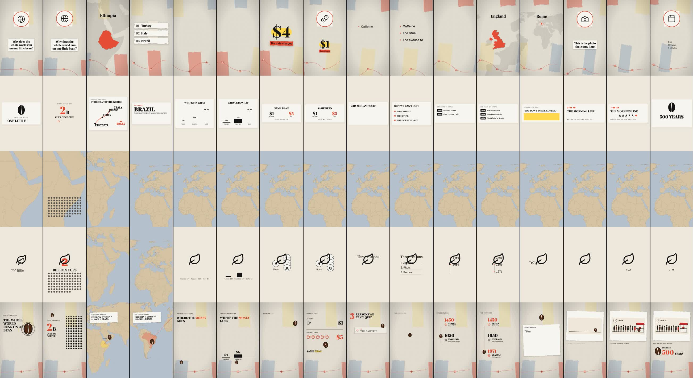
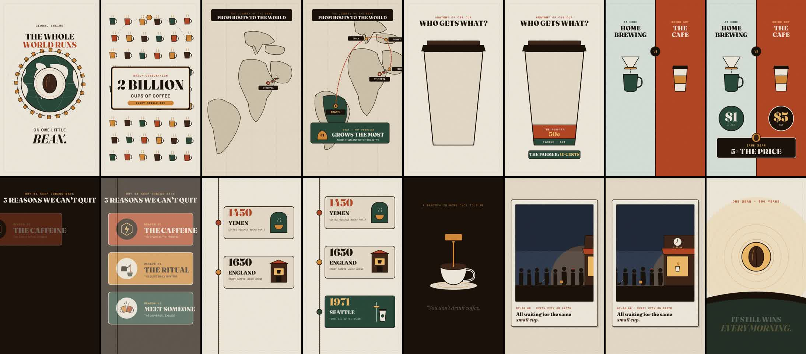
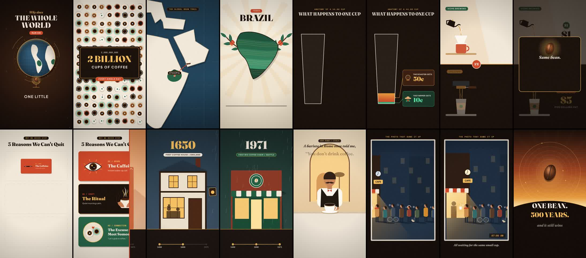

# Film-mode test: the whole video in one call (2026-11-18)

**Question.** The scene engine isn't working well enough. If a model gets only the transcript with word timings (no scene labels) and writes the **whole** video as one HyperFrames composition through the tier-2 custom contract, with a storyboard written first, is it better? How do Gemini Pro and Gemini Flash compare, and what does each cost?

No product code changed. Everything ran in the film lab (`packages/motion/scripts/film-lab/`).

## Setup

- **Script:** the founder's coffee script, 10 parts, scene labels removed (`experiments/film-mode/coffee-script.txt`). One edit: "the first Starbucks" became "the first big coffee chain" (no brand names in the repo).
- **Voice:** Gemini TTS `gemini-3.8-flash-tts`, voice Charon, 63.9 s (`coffee-voice.m4a`). The first take read the delivery note aloud and was thrown away.
- **Word timings:** local whisper.cpp (`ggml-small.en`): 179 words, free and offline (`coffee-voiceover.json`). Checked by eye: the first word is at 0 ms and the last at 63.5 s.
- **One-shot runner:** `film-lab/oneshot.ts`. One `custom` slot over the whole voiceover, from 0 to 63,921 ms. The product caps (12 s; 12k/12k/24k characters) are lifted inside the lab runner only.
  - **Prompt:** the system prompt is saved next to each run as `system.txt`. It holds:
    - the storyboard step: one shared world, one recurring element, the direction of travel, then beats the model splits itself, each with its meaning, one picture that shows it, and its seam;
    - the motion doctrine distilled from `.claude/skills/motion-doctrine`;
    - the film kit doc and the existing craft rules (`craft.ts`).
  - **Answer:** one JSON object, `storyboard` first, then html/css/script.
  - **Settings:** thinking MEDIUM, temperature 0.4.
  - **Checks:** zod, `lintCustom`, a headless run for runtime errors, and the critic. One repair was allowed, as in the product; neither run needed it.
- **Models:** `gemini-3.8-flash` and `gemini-3.1-pro-preview`. There is no `gemini-3.8-pro` for our project on the `global` endpoint (probed with `countTokens`); 3.1 Pro preview is the newest Pro it can reach.
- **Current engine:** the app's free path, run by `scripts/reel.ts`: tagger → local detection → post-pass → word drafts → scene engine, with the newsprint look and vector maps. No model calls.
- **Video:** every film is recorded by the same recorder (`film-lab/record.ts`) at 30 fps with the voice. All are 1080×1920 except Pro as generated, which was not recorded (see Videos).

## Results

| Run | Model calls | Cost | Model time | Valid on 1st try | What you see |
|---|---|---|---|---|---|
| Current engine | 0 | $0 | 18 s (whole free path) | n/a | 11 slots: centred cards, many blank frames |
| One-shot Flash 3.8 | 1 | **$0.042** | 60 s | yes | 10 beats, all content right, small cards in an empty frame |
| One-shot Pro 3.1 | 1 | **$0.082** | 53 s | yes | the world map covers the whole film |
| **One-shot Gemini 4 Hydrogen** (thinking HIGH) | 1 | **$0.32** | 281 s | yes | **best so far:** one world, one recurring bean, real pictures (see below) |
| One-shot Gemini 4 Argon / Carbon | — | — | — | — | not finished; the spend cap was hit (see below) |
| Opus (founder's video) | (no file yet) | | | | |

Costs are at official list prices, checked 2026-11-18 on the AI Studio pricing page; token counts are in each `summary.json`.
- **Flash:** 7.5k tokens in, 9.8k out. It was first logged at a stale $0.30 / $2.50 as $0.027; the real price is $0.75 / $3.75.
- **Pro:** 7.5k in, 5.6k out.
- **Hydrogen:** 7.6k in, 41.7k out, of which 25.2k were thinking.
- **Voice:** 2 TTS takes, $0.036.

Wall time for Pro was 18 minutes, but nearly all of it was the lab's headless browser drawing the world map in software rendering. The model answered in 53 s.

Rows, top to bottom: **current engine**, **one-shot Flash**, **one-shot Pro as generated**, **Pro with a hand fix** (diagnostic only, see below), **one-shot Gemini 4 Hydrogen**. The columns are at 2, 6, 10 … 62 s.

## Gemini 4 (added the same day)

The Gemini 4 models (`gemini-4-hydrogen`, `gemini-4-argon`, `gemini-4-carbon`) are served to the project on `global`. Official prices on 2026-11-18, per million tokens:

| Model | In | Out (incl. thinking) | Note |
|---|---|---|---|
| Hydrogen | $1.50 | $7.50 | Flat, no scheduled change. Google says it scores above Argon on the AA Intelligence Index (51 vs 50) |
| Argon | $2 → $4 from Dec 1 | $10 → $20 | |
| Carbon | $2 → $4 from Dec 1 | $10 → $20 | The strongest; from Dec 1 the same price as Claude Opus 5.5 |

### Hydrogen, one shot, same prompt
Valid on the first try, no runtime errors, and nothing flagged by the critic.
- **Storyboard:** "a warm newsprint broadsheet desk" as the one world. One hand-drawn roasted bean "rides map routes, anchors cost columns, hops down a 500-year timeline … leads the 7am café line".
- **What it drew:**
  - the hook with the bean in an ink globe ring, then 2B with a 200-dot field;
  - a real map flight from Ethiopia (filled) across the Red Sea to Brazil (filled), with the bean riding the route;
  - money columns in a 1:5:40 ratio;
  - one cup at home against five red cups, with "SAME BEAN";
  - "3 REASONS" with icon strips;
  - a vertical timeline (1450 Yemen, 1650 England, 1971 Seattle) with icons, the bean hopping down it;
  - a torn-paper photo of a 7 am queue at a café awning;
  - ONE BEAN · 500 YEARS.
- **Problems:**
  - Everything sits in the top half of the 9:16 frame, with empty paper below.
  - The hook title collides with the bean ("RUNS ON ON").
  - The quote card shows only "You", the same word-key failure as Pro.
  - The $4 column wasn't drawn at the sampled moment.
  - Some frames between beats are sparse.

This is the first output that looks like a film rather than slides. It costs about 8× the Flash run, and it isn't finished.

### Argon and Carbon
Not finished. Each failure is a lab problem, now fixed in `film-lab/gemini.ts`:
1. Node's `fetch` gives up after 300 s without response headers, and both models think longer than that. Fix: a plain HTTPS request with a 20-minute limit.
2. Gemini 4 caps a plain (non-streaming) REST answer at 32,768 tokens on Argon and Carbon (64K on Hydrogen) and ends with `finishReason: CONTINUATION` and a `continuationToken`. The same request has to be sent again with the token, without the partial answer ("long decode", AI Studio docs). Argon's first hop was cut mid-JSON, and Carbon's first hop was all thinking with an empty answer: $0.34 each. Fix: a continuation loop, and a total output budget of 131k.
3. With the new request, both calls died together at 191 s with `read ETIMEDOUT`: a silent connection dropped while the model thought. Fix: TCP keepalive on the socket.
4. The next attempt hit **"Spend cap breached"** on the project. No more calls until the cap is raised.

**Spend:** the ledger logged $1.16 for the day. Four calls that dropped before an answer (two at 300 s, two at 191 s) aren't in it; Google may have billed them, up to about $0.30 each.

### Current engine
- Placed 11 slots: hook, map, list, stat ×3, list, map ×2, hook, list. It never picked chart, versus, timeline or quote.
- The cup split (10¢ / 50¢ / $4) became three separate number cards. Home versus café became "$1 / Cup at home".
- "The excuse to meet someone" is cut off at "The excuse to".
- The 1450 / 1650 / 1971 timeline shows only a map of England, and the quote shows a map of Rome with a pin.
- The photo beat is a camera icon with the sentence under it.
- About a third of the frames are blank paper (0, 18, 22, 32, 42, 52 and 58 s).

### One-shot Flash
- **Storyboard:** good, and the kind asked for. One world ("an archival broadsheet the camera tracks left through"), one recurring bean, current left, and pictures with meaning: coin stacks of very different heights for farmer / roaster / café, scale plates for home versus café, a timeline tape, a queue of figures at 7 am.
- **Content:** every beat has the right words and numbers, in order, with no gaps and no invented figures. The chart, versus, timeline and quote beats all exist, which the engine never managed.
- **Code below the storyboard:**
  - Every beat is a small paper card in the middle of a mostly empty 9:16 frame. The text is small for a phone. There is no shared world or camera; the cards slide left.
  - The coin stacks never appear: the cup split shows bare labels (10¢ / 50¢ / $4.00) with a short bar or two.
  - "Turkey" and "Italy" overlap on the route, and "Brazil" is cut off at the card edge.
  - The quote's highlight is a solid yellow block, and the critic flags low contrast three times.
  - The hook's word reveal stops at "ONE LITTLE".

### One-shot Pro
- **Storyboard:** sound but plainer than Flash's ("a ledger that becomes a map and back", a bean icon as the recurring element). Its pictures are mostly direct: bars for the cup split, one coin against a stack of five, a timeline with three nodes, the quote with "the morning" highlighted, a line of dots leading to one cup.
- **As generated, the film is a map for 64 s.** It calls `mp.map()` after `mp.sheet()` and never hides it, and it hides the *sheet* during the map beat, the wrong way round. The full-frame map sits over every beat.
- **No check caught it:** lint passed, there were no runtime errors, and the critic reported one "overlap". The critic measures elements; it can't see that the picture is covered (the same gap the Suez test found).
- **Hand-fix (diagnostic, not a model output):** three `tl.set` lines show the map only during its own beat (`film-lab/handfix.ts`). With that fix:
  - The bean (a `leaf` icon) is attached outside its beat, so it stays mid-frame for the whole film and covers the list, timeline and quote.
  - The tall red $4 bar never draws, the quote stops at "You", and the 7 am queue never appears: its word `"7am,"` doesn't exist in the transcript, where Whisper wrote "7" and "a.m.,".
  - It also uses an ease that doesn't exist (`"outback"`).
  - What does work: the 2 billion count with its dot field, the map flight from Ethiopia to Brazil, the coins, the list and the timeline nodes.

## What this says

1. **The storyboard step works.** With no scene labels, both models split the voiceover into the right ten beats and proposed pictures that show the meaning (coin stacks, bars, a queue). Flash's ideas were richer. The ideas aren't the bottleneck.
2. **One call can't carry out its own storyboard.** Both answers drift from the plan, in different ways:
   - Flash plays it safe: everything right, everything small, no world.
   - Pro is ambitious and broken: one layering bug blanks the film, and wrong word keys silently drop beats.

   Neither had a way to see what it drew.
3. **It's cheap and fast.** 3 to 8 cents and about a minute for a 64 s film, against $0.40 and 6 minutes for film mode (Director → Builders → Critic) on the 37 s Suez voiceover. There's room in the budget for a few repair rounds.
4. **Against the current engine,** one-shot Flash is already more complete: every beat present, no blank frames, no cut-off list, the timeline and versus done right. It doesn't look better yet: the cards are small and there's no world or camera. As generated, Pro is worse than the engine.
5. **Our checks are blind to the two failures that mattered:** a full-frame layer covering everything, and a beat that never appears because its word key doesn't match. Both are cheap to detect with code, without a model:
   - every word key passed to `mp.at` / `on` must resolve;
   - frames sampled across each storyboard beat must differ from the frames of other beats.

Not done yet: the founder's Opus video (no file found; add it to the table and sheet when there's a path), a second run per model (one sample each; the variance is unknown), and 16:9.

## Videos

In `~/Movies/motionpop-tests/film-lab/`:
- `2026-11-18-coffee-engine-9x16.mp4`: current engine.
- `2026-11-18-coffee-oneshot-flash-9x16.mp4`: one-shot Flash.
- One-shot Pro as generated: **not recorded.** Every frame is the full-frame world map, which renders at about one frame a minute in the lab's software-rendered browser (about 30 hours for the film). The 16 stills in the sheet's third row are the evidence.
- `2026-11-18-coffee-oneshot-pro-HANDFIX-9x16.mp4`: Pro with the three-line hand fix, diagnostic only.
- `2026-11-18-coffee-oneshot-hydrogen-9x16.mp4`: one-shot Gemini 4 Hydrogen.

Each run's answer (`answer-0.json`), `params.json`, `summary.json` (storyboard, tokens, critic) and `system.txt` are in `packages/motion/.check/film-lab/oneshot-coffee-*` (gitignored).

## RAW: no Motionpop context at all (founder's ask, same day)

**Setup:** the script with word timings and a fresh creative brief (`experiments/film-mode/raw-film-brief.txt`): "world-class motion designer… one visual concept… show, don't caption… choose your own art direction… draw everything… storyboard first". The answer is one self-contained HTML page. No film kit, no looks, no craft rules, no compiler; the only contract is `window.seek(ms)` with no clocks or randomness, so the page can be recorded frame by frame. Fonts from Google Fonts are allowed; web images aren't. Runner: `film-lab/raw.ts`. Recorder: `record.ts --raw`.

| Run | Calls | Cost | Time | Valid on 1st try | Page size |
|---|---|---|---|---|---|
| Hydrogen, thinking HIGH | 1 | **$0.26** | 212 s | yes | 78 KB |
| Carbon, thinking HIGH | 3 (long-decode hops) | **$1.05** | 1,527 s | yes | 150 KB |

**This is the finding of the day.** Without our kit and rules, both models made a real art direction and illustrated the narration. Same model, same script: our context made the output worse.
- **Hydrogen** ("tactile editorial risograph"; Fraunces with Space Grotesk; a cream, espresso, terracotta and green palette):
  - a globe ringed with gear teeth around the bean;
  - 48 illustrated cups behind "2 BILLION";
  - a cutaway cup that fills in layers for 10¢ / 50¢ / $4;
  - a split screen of pour-over against to-go cup, "$1 vs $5", "5× THE PRICE";
  - icon cards for the three reasons, a timeline with little buildings, espresso pouring for the quote, an illustrated 7 am queue at a lit café, a sunrise bean at the end.
- **Carbon** ("espresso & sunlight", mid-century print): richer still.
  - full-frame illustrated 1650 coffeehouse and 1971 shopfront;
  - a barista character in a Roman arch;
  - a night street with a queue at a café;
  - pour-over against an espresso machine.
- **Weak in both:**
  - The maps are crude hand-drawn blobs.
  - Some beats are card-like.
  - Some text is small or clipped mid-transition (Carbon's reason cards).
  - Carbon's 1971 shopfront has a round green logo close to a real chain's. It must change before any demo (no third-party trademarks).
- **For the product:** Hydrogen raw is in budget, at $0.26 and about 3.5 minutes per 64 s film. Carbon is about 4× the cost and 7× the time for more illustration.

**Not checked by eye frame by frame:** that each beat lands on its word, and seams in motion. Watch the videos.
- `2026-11-18-coffee-RAW-hydrogen-9x16.mp4`
- `2026-11-18-coffee-RAW-carbon-9x16.mp4`

**Not yet looked at:** what the raw pages need to run in the product: the lint for determinism and network use, the sandbox, and composition with captions and video.
